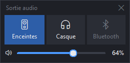
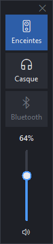

# Widget Volume


Un petit widget Windows, discret et toujours à portée de main, pour **changer de
sortie audio en un clic** (enceintes, casque, casque Bluetooth…) et **régler le
volume**. Il se colle aux bords de l'écran, s'efface quand on ne s'en sert pas
et réapparaît au survol de la souris.

<p align="center">
  
  &nbsp;&nbsp;
  
  &nbsp;&nbsp;
  
</p>
<p align="center">
  
</p>

## Fonctionnalités

- **Choix de la sortie audio** en un clic, sur trois boutons configurables.
  Une sortie déconnectée apparaît grisée et se réactive toute seule.
- **Raccourci clavier global** `Ctrl+Alt+S` : passe à la sortie suivante depuis
  n'importe quelle application.
- **Bascule automatique Bluetooth** : le son passe sur le casque Bluetooth dès
  qu'il se connecte, et revient à la sortie précédente à sa déconnexion.
- **Volume** à la barre ou à la molette de la souris, coupure du son d'un clic.
  Suit aussi les changements faits ailleurs (touches multimédia, mixeur).
- **Fenêtre aimantée** aux bords de l'écran, multi-écrans, position mémorisée.
- **Format vertical** automatique quand le widget est collé à gauche ou à droite.
- **Mode compact** (double-clic) : icônes seules, sur une ligne ou une colonne.
- **Transparent au repos**, pleinement visible dès que la souris le survole.
- **Infobulles** avec le nom complet de chaque périphérique.
- Lancement au démarrage de Windows, instance unique, net sur les écrans haute
  résolution.

## Installation

### Exécutable

Téléchargez `WidgetVolume.exe` depuis la page
[Releases](https://github.com/Jonathan2050/widget-volume/releases) et
lancez-le : un seul fichier, aucune installation ni Python nécessaire.

> Windows SmartScreen peut afficher un avertissement au premier lancement, car
> l'exécutable n'est pas signé : *Informations complémentaires → Exécuter quand
> même*.

### Depuis les sources

```bat
git clone https://github.com/Jonathan2050/widget-volume.git
cd widget-volume
py -3 -m venv .venv
.venv\Scripts\pip install -r requirements.txt
.venv\Scripts\python main.py
```

Pour construire l'exécutable vous-même : `build.bat` → `dist\WidgetVolume.exe`.

## Utilisation

| Action | Effet |
|---|---|
| Clic sur une sortie | la rend active (rôles Console, Multimédia et Communications) |
| `Ctrl+Alt+S` | sortie connectée suivante |
| Barre, molette | volume |
| Clic sur le haut-parleur | couper / rétablir le son |
| Glisser le fond | déplacer (aimanté aux bords) |
| Double-clic sur le fond | mode compact / normal |
| Clic droit | menu : options, paramètres son, configuration, quitter |

## Configuration

Le fichier `%APPDATA%\WidgetVolume\config.json` est créé au premier lancement
(clic droit → *Ouvrir le fichier de configuration*). Relancez le widget après
l'avoir modifié.

Chaque source prend le premier périphérique dont le nom contient un des textes
de `match` et aucun de ceux de `exclude` (sans tenir compte de la casse). Les
noms exacts sont visibles dans les paramètres son de Windows ou dans
l'infobulle des boutons.

```json
"sources": [
  {"label": "Enceintes", "icon": "", "match": ["S/PDIF"], "exclude": []},
  {"label": "Casque", "icon": "", "match": ["Haut-parleurs (High Definition Audio Device)"], "exclude": []},
  {"label": "Bluetooth", "icon": "", "match": ["JBL"], "exclude": ["Hands-Free"]}
]
```

`icon` est un glyphe de la police *Segoe Fluent Icons*. Autres réglages :

| Clé | Défaut | Rôle |
|---|---|---|
| `hotkey` | `Ctrl+Alt+S` | raccourci « sortie suivante » (ex. `Win+F9`) |
| `auto_switch` | `true` | bascule automatique sur la source ci-dessous |
| `auto_switch_source` | `Bluetooth` | libellé de la source à suivre |
| `vertical_on_sides` | `true` | format vertical sur les bords gauche/droit |
| `fade_when_idle` | `true` | transparent quand la souris n'est pas dessus |
| `idle_opacity` | `0.35` | opacité au repos (0.1 à 1) |
| `fade_delay_ms` | `1500` | délai avant de s'estomper |
| `snap_distance` | `24` | distance d'aimantation, en pixels |
| `volume_step` | `2` | pas de la molette, en % |

Le volume est propre à chaque sortie : Windows le mémorise déjà par
périphérique.

## Fonctionnement

- Interface en **Tkinter** (bibliothèque standard), sans dépendance graphique.
- Périphériques et volume via l'API **Windows Core Audio**, grâce à
  [pycaw](https://github.com/AndreMiras/pycaw) et
  [comtypes](https://github.com/enthought/comtypes).
- Windows n'offre pas d'API publique pour changer la sortie par défaut : le
  widget utilise l'interface COM non documentée `IPolicyConfig`, la même que
  les outils du même genre.
- Raccourci global par `RegisterHotKey`, dans un thread dédié.

| Fichier | Rôle |
|---|---|
| `main.py` | point d'entrée (instance unique, DPI) |
| `widget_volume/audio.py` | sorties audio et volume |
| `widget_volume/ui.py` | fenêtre, dispositions, aimantation, bascule auto |
| `widget_volume/widgets.py` | bouton de source, barre de volume, infobulle |
| `widget_volume/winutil.py` | écrans, raccourci global, instance unique, démarrage auto |
| `widget_volume/config.py` | lecture et écriture de la configuration |
| `tests/` | tests de la logique, sans matériel audio |

Tests : `.venv\Scripts\python -m unittest discover tests`

## Crédits

Projet de [Jonathan2050](https://github.com/Jonathan2050), développé en
collaboration avec **Claude Opus 5.5** (Anthropic).

## Licence

[MIT](LICENSE) : libre d'utilisation, de modification et de redistribution, y
compris commerciale, à condition de conserver la mention de copyright.

Les dépendances ont leurs propres licences, compatibles : pycaw et comtypes
(MIT), psutil (BSD), PyInstaller (GPL avec exception, qui autorise la
distribution de l'exécutable sous n'importe quelle licence).
